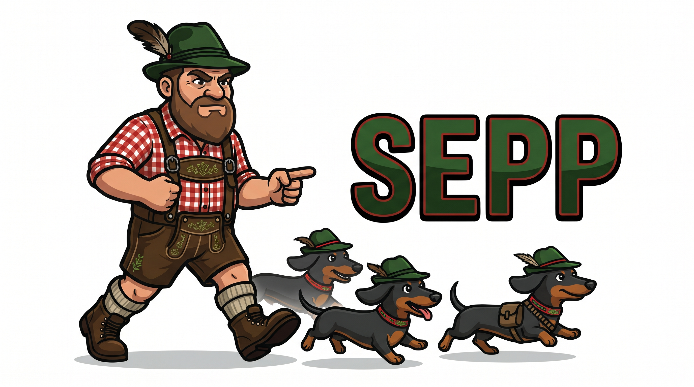

<p align="center">
  
</p>

# SEPP (Someone Else's Prompt Problem)

Agentic security testing for **LLM-enabled APIs** — OWASP Top 10 for LLM Applications plus classic API weaknesses (BOLA/IDOR, JWT/OAuth, injection). A controller agent delegates hunt legs to hunter subagents. All target traffic flows through **Caido**, reusing your authenticated browser sessions; findings are proven with reproduced request pairs. NVIDIA **garak** reaches non-standard endpoints via a target-blind OpenAI shim.

```
operator ──orders──▶ controller ──legs──▶ hunter subagents
                        │
                        ├─ caido-cli            history / replay / batch (proxied)
                        ├─ garak battery ──────▶ OpenAI shim ─┐
                        └─ exploit battery ────▶ testbed/target
                                                ▼
                                          Caido :8080 ◀── browser (auth)
```

> **Authorized testing only** — your own apps or systems with written authorization. No liability for misuse.

## Requirements

| Need | Minimum |
|---|---|
| Caido + `caido-cli` + `caido-mcp-server` | proxy on `127.0.0.1:8080` |
| Python | ≥ 3.12 (garak venv) · ≥ 3.10 (control fixtures) |
| Node / uv / Docker | ≥ 20 / latest / for the testbed |
| Driving LLM key | Venice (`VENICE_API_KEY`); presets in `sepp.sh`: default `glm-5-3-flash-uncensored`, `deepseek`, `go` |

## Setup

```bash
make setup        # prerequisites, CLIs, plugin build, CA export, pinned garak venv, smoke test
```

1. `CAIDO_URL=http://127.0.0.1:8080 caido-mcp-server login` (re-run on auth errors)
2. Caido UI → Plugins → Install from file → `plugins/sepp/dist/plugin_package.zip`
3. `./sepp.sh` once → set `VENICE_API_KEY` in the generated `.env`
4. Log into the target in a browser proxied through Caido — agents harvest credentials from history

## Operating

Only two steps are physically yours: **start Caido** and **browse/log into the target through its proxy** (that feeds credentials into history). Everything else you order from the agent shell; the controller runs all tooling itself (`AGENTS.md` is its contract).

```bash
./sepp.sh | sepp.sh deepseek | sepp.sh go | sepp.sh --check
```

| Order (say it or type it) | Effect |
|---|---|
| *"prep the environment for \<url\>"* | Controller checks Caido/auth, exports CA, harvests creds, wires the adapter — or names exactly what's missing |
| `/hunt-start <url>` · `/hunt-scope <host>` | Arm ledger + scope |
| *"run stealth / aggressive / full power"* | Potency ladder: burst size, pacing, probe classes, battery ceiling (`stealth`=smoke only … `full`=everything) |
| *"orient …"* → *"go"* | Read-only recon → probe plan → hunters execute on your go |
| *"skip mapping, go straight to prove"* | Jump phases forward/back on order |
| `/hunters` · `/hunt-status` · `/findings` | Live board · disk-derived status · evidence ledger |
| `/hunt-abort <name>\|all` | Stop one hunter or everything, immediately |
| *"close the hunt"* / *"prune finished workspaces"* | Mark closed → dry-run cleanup report → delete only on your confirm |
| `/hunt-brief` | Interpretive close-out: conclusions with request IDs, decisions, next steps |

Escalation rule: state-changing or destructive probes reach you for approval first — the agent never approves for itself.

## Session commands

| Command | Purpose |
|---|---|
| `/menu` · alt+g | Capability hub: templates, hunt starters, toolchain check |
| `/capabilities` · `/caps` | Machine-derived sheet: ladder+binding, battery profiles, all commands, make targets |
| `/hunt` | Legacy ledger hub: start/here/phase/report |
| `/hunt-start <url>` · `/sepp` | Arm ledger for a target |
| `/hunt-scope <host…>` · `/sepp-scope` | Merge hosts into the Caido scope |
| `/hunt-status` · `/sepp-status` | Deterministic status from disk |
| `/hunt-brief` · `/sepp-brief` | Interpreted engagement brief |
| `/hunt-abort [name\|all]` · `/sepp-abort` | Stop hunters (cooperative, then kill sweep) |
| `/hunters` | Live hunter board |
| `/findings` | Findings ledger |
| `/sessions` · `/sepps` · `/hunt-resume` · `/hunt-refresh` · `/prune-hunt-session` | Workspaces, resume, re-harvest, interactive prune |
| `/sepp-target-clear` | Clear the target panel |

## Tooling

| Capability | One line | Entry |
|---|---|---|
| Exploit playbooks | Hands-on repro per OWASP LLM01–LLM10, fact-checked against the testbed | `docs/exploits/` + `payloads/` |
| Exploit battery | All ten exploits vs testbed at `naive`/`strict`, graded vs expectations, optional headless-Chrome exfil proof | `make llm-exploits` |
| Garak battery | Profiled model-layer probes via shim; rehearsal-predicted budgets (measured 11/1076/1735, ceilings 12/1200/1800); `--list` shows options; potency-bounded; gate-ready reports | `scripts/garak_battery.py --profile … --potency …` |
| Gate | Pass/fail/blocked verdicts from battery reports + policies, fitted calibration, negative controls | `scripts/llm_gate.py` |
| Job harness | Config-driven payload matrices with `expect {status, contains, absent}`; write-gated, size-disciplined | `helpers/llm_job_harness.py` |
| Exfil rig | Loopback listener + Caido-proxied headless Chrome; listener verdict + DOM evidence | `scripts/prove_exfil.py` |
| Canary | Single-probe identity-checked shim run, report-verified | `make testbed-canary` |
| Onboarding | Wire any endpoint as a target: adapter + offline check + credential harvest | `scripts/onboard_target.py wire` → `check_adapters.py` → `harvest_target.py` |

Shim conversation modes: `SEPP_SHIM_CONV=fresh|reuse` (`reuse` = threaded multi-turn, serial-runs only); rotating sessions retry one 401 via refreshed on-disk credentials.

## Testbed

Vulnerable FastAPI app, routes mapped to LLM01–LLM10, guard tiers `off`/`naive`/`strict`:

| Target | Action |
|---|---|
| `make testbed-up` / `-seed` / `-reseed` | start on `127.0.0.1:8765` · seed via Caido · fresh volume |
| `make testbed-verify` | full expectation matrix |
| `make testbed-canary` | garak canary through the shim |
| `make testbed-down` | stop |

Credentials & knobs: `testbed/README.md`.

## Environment variables

| Variable | Meaning |
|---|---|
| `CAIDO_TARGET` | target slug under `data/targets/` (default `testbed`) |
| `CAIDO_URL` / `CAIDO_PROXY` / `CAIDO_DATA_DIR` | Caido instance / proxy / data root |
| `SEPP_RATE_PAUSE` | request pause override (env › `target.json` › 10 s) |
| `SEPP_SHIM_CONV` / `SEPP_SHIM_CONV_MAX_TURNS` | shim conversation mode / cap (10) |
| `SEPP_GARAK_HOME` | garak venv root (default `.venv-garak`) |

## House rules

- Delegated hosts only; all target traffic through Caido.
- ≤ 50 requests/burst; pauses between batches; stop on 5xx storms.
- Findings need reproduced request pairs; no secrets in reports or chat.

## Verify

```bash
./scripts/smoke.sh                                         # Caido reachability, CLI auth, helpers
python3 -m unittest discover -s scripts -p "test_*.py"     # + -s helpers
python3 scripts/check_adapters.py                          # adapter contracts
make testbed-verify                                        # expectation matrix
```

More: `ROADMAP.md` (program status) · `docs/llm-control-verification.md` (gate workflow) · `docs/llm-2026-acceptance-map.md` (risk↔issue trace) · `docs/llm-test-program-implementation.md` (plan).
