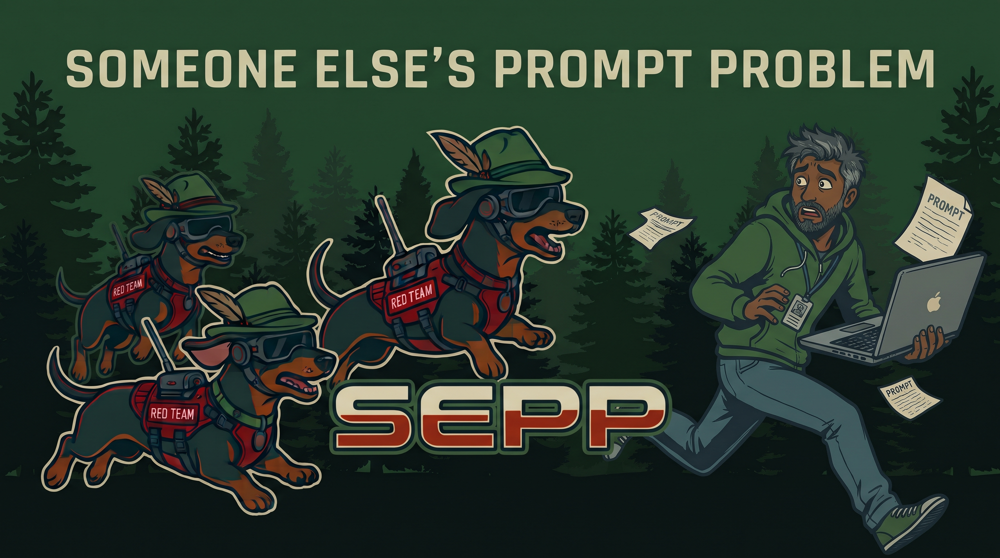

# SEPP (Someone Else's Prompt Problem
<p align="center">
  
</p>

## Overview

SEPP (Someone Else's Prompt Problem, sometimes Someone Else's Production Problem) is an agentic red-team stack, which enables a team of controller + hunter agents to autonomously drive the Caido proxy via caido-cli: 
* orient on real traffic
* hunt exploitable weaknesses in your API
* prove each finding with reproduced request pairs
* record it
  
All through your own proxy, with your own authenticated sessions.

Security-testing agent: **pi** (model-agnostic coding agent) drives the **Caido**
proxy through `caido-cli` to investigate delegated URLs, prove issues with
reproduced before/after evidence, and record findings in Caido + `data/reports/`.

```
operator ──delegates URL──▶ pi agent (AGENTS.md = methodology)
                              │ bash
                              ├── caido-cli      send/raw/batch/history  (primary)
                              ├── helpers/*      findings, JWT, OAuth, LLM harness
                              └── ffuf / jwt / jq
                                    ▼ (all traffic proxied)
                        Caido :8080 ◀── operator's browser (auth lives here)
```

## Requirements

- **Caido** — the proxy must be installed and running locally (`127.0.0.1:8080`);
  SEPP inspects and replays traffic through it. [caido.io](https://caido.io)
- **Caido CLI** (`caido-cli`) — required for history browsing, request replay and
  batch sweeps from the agents (`brew install caido-cli caido-mcp-server`).
- **Security-capable model** — the driving agent needs a model willing to act on
  offense-oriented prompts (recon, exploitation, payload crafting). Filtered or
  refuse-heavy models stall the hunt. Tested models (both hosted on Venice):

  | Model | Venice model id |
  |---|---|
  | GLM 5.3 Uncensored | `glm-5-3-flash-uncensored` |
  | DeepSeek 4.1 Uncensored | `deepseek-4_1-uncensored` |

## One-time setup (ONE command)

```
make setup
```

Idempotent full local install — verifies/builds everything and ends with the
SEPP plugin install URL + checklist:

1. prerequisites (node ≥ 20, python3, uv — installs uv via brew if missing)
2. **pi** coding agent (npm global if missing)
3. **caido-cli** + **caido-mcp-server** (community installer if missing)
4. **SEPP plugin** build + package (`plugins/sepp/dist/plugin_package.zip`)
5. global **`sepp`** command (symlink `~/.local/bin/sepp` — the Caido→Hunt bridge)
6. provisioning via `sepp.sh --setup-only`: Caido reachability/auth, CA export,
   garak venv (`.venv-garak/`, Python 3.12 via uv), pi models/theme/settings
7. smoke test + summary with the `file://` install URL and token expiry

Manual details of each step below (useful when `make setup` flags something ⚠).

## Details

### Manual steps (behind `make setup`)

1. **Caido**: running, proxy visible at `127.0.0.1:8080`. Log into the target
   site in your browser *through the proxy* once — tokens then appear in
   history and the agent harvests them; you never paste secrets.
2. **Caido auth for tooling**:
   ```
   brew install caido-cli caido-mcp-server        # or: npm i -g / download per vendor docs
   CAIDO_URL=http://127.0.0.1:8080 caido-mcp-server login
   caido-cli status -u http://127.0.0.1:8080
   ```
3. **Caido MCP extension for pi** (lets the agent query proxy history directly):
   `.pi/mcp.json` is already in this repo; it runs `caido-mcp-server serve`
   over stdio and piggybacks on the token from step 2. Sanity check:
   ```
   pi -p "call the caido history/list tool with limit 1"
   ```
   Token lives in `~/.caido-mcp/tokens/` (expires ~weekly — re-run `login`
   when the agent reports auth errors; the existing one expires 2026-11-26).
4. **SEPP plugin for Caido** (right-click → declare a request Somebody Else's
   Problem): first-party Caido plugin living in `plugins/sepp/` — source, build
   and packaging are part of this repo (Makefile). Build both halves:
   ```
   make plugin-build              # -> plugins/sepp/dist/plugin_package.zip
   make install-cli               # global `sepp` command (symlink ~/.local/bin)
   ```
   Install the zip in Caido: Plugins → Install from file. Afterwards:
   right-click any request in HTTP History → **SEPP: send to Hunt** → Run.
   The request (metadata + exact raw bytes) lands in the live Hunt TUI as a
   queued message. (Menu/command patterns adapted from six2dez/dispatch, MIT
   — see the plugin's NOTICE.)
5. **Model for pi** (uncensored, OpenAI-compatible — Venice hosts both choices):
   ```
   export OPENAI_API_KEY=<venice-key>          # Venice API key
   export OPENAI_BASE_URL=https://api.venice.ai/api/v1
   # GLM: model id glm-5-3-flash-uncensored ... or deepseek-4_1-uncensored
   pi --model openai/glm-5-3-flash-uncensored
   ```
   (Verify exact model slugs with the Venice models endpoint; the flag is all
   that changes between the two models.)

## Daily use

```
cd ~/projects/caido-integration
./sepp.sh            # default: GLM flash (venice) — controller session
./sepp.sh go         # OpenCode Go model (SEPP_GO_MODEL, default deepseek-v4-flash):
                    #   prompt-cache extensions activate; cheap long sessions
./sepp.sh --check    # smoke-test the plumbing
```

Then chat: `target: https://api.x.test/v2/orders — sepp`

Pi packages auto-managed by `make setup`: `pi-subagents` (delegation),
`pi-opencode-go-cache` (Go-provider caching), `pi-cache-optimizer`
(provider-generic cache stats). *(Third-party `pi-redteam` was dropped —
superseded by the in-repo `sepp-redteam` extension below.)*

#### sepp-redteam (first-party, `.pi/extensions/sepp-redteam.ts`)

Local fork & fix of `pi-redteam` 1.0.5 (post-mortem: `../redteam-review/`,
ISSUES rows 31–32). The hunt itself stays governed by AGENTS.md
(`/sepp` → controller → hunter subagents); this extension adds ONLY the
structured ledger + phase tracker. It performs no network I/O — findings
without evidence are rejected by convention, warned by tool:

```
/hunt                       # status (also mirrored in the target panel)
/hunt start <url>           # arm the ledger for a target (no prompting tricks)
/hunt here <url> [notes]    # FULL RED TEAM IN THIS SESSION — arms the ledger AND
                            # injects the engagement kickoff (real tools unlocked;
                            # scope/rate/approval rules stay binding; ledger secondary)
/hunt phase <name>          # orient|map|hypothesize|prove|record|report
/hunt report                # write data/reports/sepp-redteam-<ts>.md
```

Agent tools: `sepp_record_finding` (evidence-checked findings sink —
severity/status(proven·probable·hunch)/Caido-request-id) and `sepp_coordinate`
(phase + tested/pending/blocked coverage). Unlike upstream: working bare-command
handling, persistent session state (custom entries, survives /tree), current
pi API (`typebox`), and no fabricated "analysis" — the tool stores exactly what
the model cites and nudges it toward request pairs.

The npm `pi-redteam` package was uninstalled on 2026-11-22 (operator decision;
recorded in ISSUES row 33).

**Disk ledger** (dual-write): every ledger mutation also lands as
`phase.json` + `findings.json` — written atomically — into the first of:
`$SEPP_REDTEAM_LEDGER_DIR` → the active session workspace (set by `/sepp`) →
`data/sepp-redteam/`. A fresh session hydrates from that ledger (workspace
 Hunts and hunters in other processes can read it; corrupt ledgers are
announced, never silently reset. Runtime-verified via
`node scripts/dev_smoke_sepp_redteam.mjs happy|restore|corrupt` (stubbed pi;
the `.pi/extensions/node_modules` symlinks exist for that harness only — pi
itself resolves modules through its own loader).

The main session runs as the CONTROLLER: it orients on Caido history, plans,
assigns hunt legs, verifies evidence and reports to you. The hands-on work
(mapping, probing, proving) executes in a `hunter` SUBAGENT (pi-subagents
extension, project agent `.pi/agents/hunter.md`) — launched in the background,
so the controller stays available for you; escalation questions (destructive
probes etc.) come back through the supervisor channel for YOUR decision.

#### Hunter board (who is hunting what, live)

Every hunter heartbeats `scripts/hunter_board.py` (mandated in AGENTS.md and
`.pi/agents/hunter.md`). In pi:

- the **hunters widget** under the editor lists live rows: `● name  phase  last activity`
- **/hunters** opens the full board — pick a row to drill into target, phase,
  workspace, latest evidence files and the report tail.

Outside pi: `python3 scripts/hunter_board.py list` (or `get <name>` for JSON).
States: `● active` (<10 min since heartbeat) · `○ quiet` (>10 min — watchdog
hint) · `✓ done` (kept 24 h).

**Control:** `/hunt-abort <name>` requests a COOPERATIVE stop for one hunter —
its board row flips to `⏹ stopping` and the hunter winds down at its next row
check (before every probe batch), saving interim findings. This is subagent-safe:
pi hunters run behind throwaway bash shells, so a SIGTERM can't reliably reach
them. `/hunt-abort all` is the panic button — SIGTERM→SIGKILL sweep over
registered PIDs PLUS stop-requests on every live row (covers in-process agents).
Bare `/hunt-abort` opens a picker fed by the live board.

**Engagement brief:** `/hunt-status` (alias `/sepp-status`) (optionally `/sepp-status <workspace-id-substring>`)
assembles the controller's leg-closing report straight from disk — no model in
the loop, so it cannot embellish: where the hunt stands (legs closed, live
hunters, findings count), the attack-surface table straight from the ledger
(severity badges, proven/probable/hunch per row), an honest-conclusion block
(counts positive controls separately, calls out hunches), plus decisions
needed and next steps parsed from the latest workspace report. Full facts
saved to `data/reports/sepp-status-<ts>.md`.

**Top menu:** `alt+g` (or `/menu`; override via `SEPP_MENU_KEY`)  — the SEPP capability hub inside pi: prompt
templates from `.pi/templates/*.md` pasted into the editor for review (nothing
auto-sends), hunt starters with URL staging, brief/board shortcuts, a
confirm-gated `make setup` runner, and a loaded-tools + SEPP-toolchain
inventory. Loops until CANCEL. Place new capabilities as template files or
entries in `sepp-menu.ts`.

**Interpreted brief:** `/hunt-brief` (alias `/sepp-brief`) — facts alone don't conclude; the session
agent acts as SOLE COORDINATOR: it reads the full workspace reports on top of
the deterministic facts and WRITES the interpretation (honest conclusion,
decisions with recommendations/costs, next steps tagged read-only vs
needs-approval) to `data/reports/sepp-brief-latest.md`. Read it with
`/sepp-brief show`. Guardrails in the prompt: no invented findings, hunches
stay labeled, every claim cites a request id or file, disagreements with the
facts must be called out.

**Forensics:** `/sessions` (alias `/sepps`) now drills down — pick a workspace and get: per-dir
contents (scripts/tools/evidence/reports), every board hunter bound to it with
its last phase + stop reason, the five newest evidence files with timestamps,
and the report tail. That is the "what did they work on, where did they
stop" view.

Under the hood: AGENTS.md (mission, rules, delegation split, report format),
oriented via `caido-cli history` → hunter legs prove with replay diffs →
`helpers/findings.py create` → markdown report in the session workspace.

Key rules: scoped hosts only, ≤50 req/burst with ≥10 s pause, destructive
probes need your OK, tokens never printed in cleartext.

## Layout

Code (committed) vs data (never committed — tokens, captured traffic, reports):

| Path | Kind | Purpose |
|---|---|---|
| `AGENTS.md` | code | mission, hard rules, test-class priorities, report format |
| `ISSUES.md` | code | running ledger of tooling issues: symptom/root cause/fix/verification |
| `.pi/agents/hunter.md` | code | project subagent definition: the HUNTER that executes hunt legs for the controller session |
| pi packages | runtime | `pi-subagents` (controller→hunter delegation) · `pi-opencode-go-cache` (prompt caching — dormant for the default `venice` models, active on OpenCode Go models) |
| `scripts/setup_local.sh` | code | one-command local workstation install (`make setup`) |
| `Makefile` | code | developer targets: `make setup`, plugin build/pack/clean, `install-cli` |
| `BACKLOG.md` | code | feature backlog: done + open items with design decisions |
| `scripts/sepp.sh` | code | Caido→Hunt bridge: receiver, writes SEPP declarations into `data/spool/`; global `sepp` via `make install-cli` |
| `plugins/sepp/` | code | first-party Caido plugin (source + build): right-click → SEPP: send to Hunt; `make plugin-build` |
| `sepp.sh` | code | launcher: loads `.env`, validates model slug, prefights Caido, starts pi |
| `helpers/` | code | findings ledger, JWT/OAuth analysis, LLM-job harness, ffuf wrapper |
| `drivers/` | code | target-blind stack: transport (paced Caido-proxy HTTP), universal OpenAI shim for garak (`CAIDO_TARGET`), adapter loader + legacy chatdriver facade |
| `scripts/` | code | smoke, CA export, cookie harvester, garak canary runner |
| `payloads/` | code | payload lists used by harness/probes |
| `testbed/` | code | local vulnerable-app testbed (guards off/naive/strict, OWASP LLM Top 10 route map, see `testbed/README.md` + `PLAN.md`) |
| `data/` | **data** | per-target creds/requests (`data/targets/<slug>/`), CA pem, reports, garak output, tmp — **gitignored, contains secrets** |
| `.env` | data | API keys — gitignored |

Env knobs: `CAIDO_TARGET` (selects `data/targets/<slug>/`, default `testbed`),
`CAIDO_DATA_DIR` (default `./data`), `CAIDO_PROXY`, `SEPP_RATE_PAUSE`.

## Verify the plumbing

```
./scripts/smoke.sh        # checks: caido reachable, CLI auth, helpers --help clean
```
