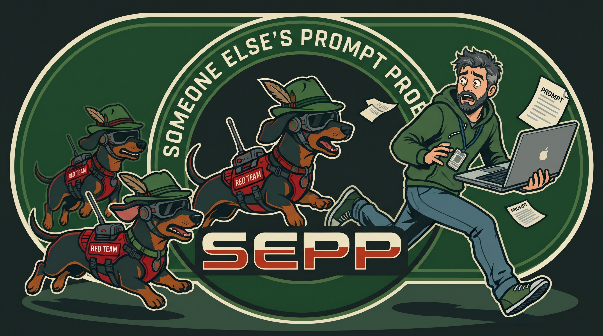

<p align="center">
  
</p>

# SEPP (Someone Else's Prompt Problem)

SEPP is an agentic security-testing stack for **LLM-enabled APIs**, targeting the **OWASP Top 10 for LLM Applications (2025/2026)** plus classic API weaknesses (BOLA/IDOR, JWT/OAuth, injection, mass assignment).

A controller agent delegates hunt legs to hunter subagents. All target traffic flows through **Caido** (`caido-cli`), reusing your authenticated browser sessions from proxy history, and every finding is backed by a reproduced before/after request pair. NVIDIA **garak** probes reach non-standard endpoints through a target-blind OpenAI shim; application-layer controls are verified by deterministic batteries against the bundled vulnerable testbed.

```
operator ──delegates URL / Caido right-click──▶ pi controller ──▶ hunter subagents
                                                   │
                                                   ├── caido-cli        history, replay, batch sweeps
                                                   ├── helpers/*        findings, JWT, OAuth, LLM job harness
                                                   ├── garak battery ──▶ OpenAI shim (drivers/openai_shim.py)
                                                   └── exploit battery ─▶ testbed / target routes
                                                                            ▼ (all traffic proxied)
                                                                      Caido :8080 ◀── browser session (auth)
```

## Disclaimer

> **For educational and authorized security testing only.** Use only against your own applications or systems for which you have explicit, written authorization. The author is not responsible for misuse, unauthorized testing, or damage.

## Requirements

- **Caido** on `127.0.0.1:8080` ([caido.io](https://caido.io)) with **caido-cli** and **caido-mcp-server**
- **Python** — ≥ 3.12 for the garak venv (`garak 0.17.x` will not install on older interpreters); ≥ 3.10 for the control fixtures (`testbed/controls`)
- **Node.js ≥ 20**, **uv**, **Docker** (testbed)
- **Driving LLM API key** — the agent needs a model that executes offensive-security tasks without refusing. Tested on Venice (IDs must match `sepp.sh`):

  | Preset | Venice model ID |
  |---|---|
  | default | `glm-5-3-flash-uncensored` |
  | `deepseek` | `deepseek-v4-1-flash-uncensored` |
  | `go` | `deepseek-v4-flash` (override: `SEPP_GO_MODEL`) |

## Setup

```bash
make setup          # idempotent: prerequisites, pi/caido CLIs, plugin build, CA export,
                    # garak venv (.venv-garak, versions pinned in requirements-garak.txt), smoke test
```

After `make setup`:

1. Authenticate the Caido CLI/MCP (re-run on auth errors):
   ```bash
   CAIDO_URL=http://127.0.0.1:8080 caido-mcp-server login
   caido-cli status -u http://127.0.0.1:8080
   ```
2. Install the Caido plugin: **Plugins → Install from file** → `plugins/sepp/dist/plugin_package.zip`.
3. Run `./sepp.sh` once to generate `.env`, then set `VENICE_API_KEY`.
4. Capture auth: log into the target application in a browser proxied through Caido. Hunters harvest tokens/cookies from proxy history — never paste secrets.

`sepp.sh` also repairs stale `.venv-garak/bin` shebangs after repo moves (renames bake absolute paths into entry scripts).

## Steering a red-team investigation (operator view)

You steer; the agents work. The controller knows the full procedure (see `AGENTS.md`) and runs every project script itself — you never invoke tooling by hand. Your inputs are chat orders, slash commands, approvals, and stop signals at any time (`/hunt-abort all`).

Only two steps are physically yours (no API can do them): **start Caido** (desktop app, proxy on `127.0.0.1:8080`) and **route your browser through that proxy, then log into the target application** — that login is what puts fresh credentials into proxy history. One-time afterwards: `make setup`, Caido plugin install, `.env` → `VENICE_API_KEY` (details in Setup above).

Then the whole engagement from the agent shell:

| Phase | You say / type | Agent does (autonomously) |
|---|---|---|
| Session | `./sepp.sh` (once) | Boots as **controller** |
| Bootstrap | *"prep the environment for https://api.example.com"* | Verifies Caido + CLI auth, exports CA, harvests freshest credentials from history, wires/checks the target adapter, reports each result — or tells you precisely what is missing (e.g. "no authenticated traffic for this host in history") |
| Arm | `/hunt-start https://api.example.com` · `/hunt-scope api.example.com` | Arms the findings/phase ledger and scope (equivalent: just say *"start a hunt against …"*). Say *"isolated workspace for this hunt"* and the hunt runs in its **own** workspace (`<date>-<host>--<hunt>`), parallel to any other hunt on the same host |
| Potency | *"run stealth"* / *"go aggressive"* / *"full power, but ask before writes"* | Sets the potency level (ladder in `AGENTS.md`: `stealth` → `standard` → `aggressive` → `full`) — governs burst size, pacing floor and probe classes for every hunter, changeable mid-hunt, recorded in the workspace. The bound also caps **battery profiles**: `stealth` may only run the smoke garak battery (12 requests), `standard` adds core, `aggressive`/`full` unlock full — over-bond requests are refused, raising potency is your explicit order |
| Orient | *"orient on the target, plan the hunt"* | Reads Caido history (zero attack traffic), maps endpoints/auth/object-IDs, proposes a prioritized probe plan **and waits for your go** |
| Jump | *"skip mapping, go straight to prove"* / *"back to orientation with the new creds"* | Phases are skip-forward and skip-back on your order; scope/escalation gates still apply at every phase |
| Hunt | *"go"* / *"run the exploit battery"* / *"run the smoke garak battery"* | Spawns background **hunter** subagents per leg; they hypothesize, run cheapest-experiment probes through Caido, and prove each issue with a legit-vs-manipulated request pair |
| Approve | controller relays hunter escalations | You decide *"yes, run the DELETE test"* / *"skip that"* — the agent never approves for you |
| Track | `/hunters` · `/hunt-status` · `/findings` | Live board, deterministic disk-derived status, evidence ledger citing Caido request IDs |
| Stop | `/hunt-abort <name>\|all` — any time, instantly | Cooperative stop per hunter or kill sweep; controller follows with `hunter_board.py stop <name> --kill` for anything that ignores the flag |
| Cleanup | *"close the hunt"* / *"clean up finished workspaces"* / *"wipe workspace <id> — confirm"* | Controller finishes hunters, marks the workspace closed, and prunes: dry-run report first, deletion only on your confirmation (`workspace.py prune … --apply`) |
| Close | `/hunt-brief` | Interpreted brief: where the hunt stands, honest conclusions with request-ID citations, decisions needed with costs, next steps marked `[read-only]` or `[needs approval]` |

Reports, workspaces and evidence accumulate under `data/workspaces/<host-per-day>/` and `data/reports/` for later sessions (`/sessions`, `/hunt-resume`).

Want to rehearse safely first? Say *"prep the environment for the testbed"* — the controller starts and seeds the local vulnerable app and you can run the entire loop against `http://127.0.0.1:8765` (credentials in `testbed/README.md`).

## Usage

```bash
./sepp.sh            # default model
./sepp.sh deepseek   # DeepSeek preset
./sepp.sh go         # OpenCode Go model (SEPP_GO_MODEL)
./sepp.sh --check    # verify plumbing without launching pi
```

Delegate a target in chat (`target: https://api.example.com/v2/chat`) or right-click a request in Caido HTTP History → **SEPP: send to Hunt**. The controller orients on history, plans, and verifies evidence; background hunters probe. State-changing probes escalate to you first.

### Session commands (registered in `.pi/extensions/`)

| Command | Purpose |
|---|---|
| `/menu` | Capability hub: prompt templates, hunt starters, toolchain check |
| `/capabilities` · `/caps` | Capability sheet: potency ladder with battery binding, garak profiles, every slash command, make targets — parsed from the repo, so it never advertises more than exists |
| `/hunt` | Current hunt status and ledger |
| `/hunt-start <url>` · `/sepp` | Arm the findings/phase ledger for a target |
| `/hunt-scope <url-or-path>` · `/sepp-scope` | Set the delegated target scope |
| `/hunt-resume` · `/hunt-refresh` | Resume or reload a hunt ledger |
| `/hunt-status` · `/sepp-status` | Deterministic status report from disk |
| `/hunt-brief [show]` · `/sepp-brief` | Interpreted brief with recommendations |
| `/hunt-abort [<name>\|all]` · `/sepp-abort` | Cooperatively stop hunters |
| `/hunters` | Live hunter board (status, phase, workspace, evidence) |
| `/findings` | Current findings ledger |
| `/sessions` · `/sepps` | Inspect workspaces, evidence files, report tails |

Outside `pi`: `python3 scripts/hunter_board.py list`.

## Testing capabilities

### 1. Exploit playbooks (OWASP LLM Top 10, 2025 numbering)

`docs/exploits/` — one hands-on playbook per risk (LLM01–LLM10), every command fact-checked against the testbed; companion payload lists in `payloads/`.

### 2. Application exploit battery — deterministic, tier-aware

`scripts/exploit_battery.py` replays all ten exploits against the testbed at `naive` and `strict` guard tiers, reseeding between tiers and grading each observation against `testbed/EXPECTATIONS.md`; `--with-exfil-rig` adds a real headless-Chrome exfiltration proof (canary listener + rendered-markup execution, `--assert-absent` verdict at strict).

```bash
make llm-exploits    # full battery incl. exfil rig; JSON report in data/reports/
```

### 3. Model-layer garak battery — profiled, budget-enforced

`scripts/garak_battery.py` runs `configs/garak_profiles.json` probe profiles (selected **by name**, never `owasp:*` tags) through the OpenAI shim. Preflight census enforces request ceilings (smoke 12, core 414, full 628) **before any traffic**; reports count distinct provider requests and feed `scripts/llm_gate.py` policies (pass/fail/blocked verdicts, fitted calibration plus negative-control validation).

```bash
python3 scripts/garak_battery.py --profile smoke --dry-run   # budget census only
SEPP_RATE_PAUSE=2 python3 scripts/garak_battery.py --profile core   # default potency: standard
python3 scripts/llm_gate.py <policy.json> <report.json> --profile smoke
```

Profiles are potency-bounded (`--potency`, default `standard`; ladder in `AGENTS.md`): `stealth` runs smoke only, `standard` smoke+core, `aggressive`/`full` everything. The controller derives `--potency` from the hunt workspace's `session.json`, so a low-potency hunt cannot spend a heavy battery without the operator raising potency first — over-bond runs are refused before any setup.

Single-probe canary: `make testbed-canary` (identity-checked shim + `dan.DAN_Jailbreak`, report verified by `scripts/verify_garak_report.py`).

### 4. Targeted API & LLM job probing

`helpers/llm_job_harness.py` — config-driven payload matrices with `expect {status, contains, absent}` verdicts, response-size discipline (truncated bodies can never pass `absent`), write-method gating, and optional Caido request-id attachment. Around the model: `helpers/jwt_tools.py`, `helpers/oauth_flow.py`, `helpers/discover.sh`, `caido-cli batch`.

### 5. Exfiltration proof rig

`scripts/canary_listener.py` (fixed-port loopback journal), `drivers/headless_render.py` (Chrome via Caido), `scripts/prove_exfil.py` (listener-verdict + DOM evidence, `--assert-absent` for strict tiers). Unit-tested offline in `scripts/test_exfil_rig.py`.

## Local OWASP LLM testbed

A deliberately vulnerable FastAPI app (`testbed/`) with routes mapped to LLM01–LLM10 and guard tiers `off` / `naive` / `strict`:

```bash
make testbed-up        # start on 127.0.0.1:8765
make testbed-seed      # seed accounts & traffic through Caido
make testbed-reseed    # down -v + up (fresh marker, fresh seed data)
make testbed-verify    # full off/naive/strict expectation matrix
make testbed-canary    # garak canary via the shim
make testbed-down      # stop stack
```

Credentials and knobs: `testbed/README.md`. Control verification workflow (incl. Ollama `qwen2.5:7b` runs and the application gate): `make llm-smoke`, `make llm-battery LLM_PROFILE=core`, documented in `docs/llm-control-verification.md`. Current program status and remaining work: `ROADMAP.md`; risk-to-issue traceability: `docs/llm-2026-acceptance-map.md`.

## Target onboarding

Non-testbed endpoints are wrapped per target under `data/targets/<slug>/`:

```bash
python3 scripts/onboard_target.py wire --slug <slug> --url <url> [--dialect json|sse] [--from-request <caido-id>]
python3 scripts/check_adapters.py <slug>                     # offline adapter validation
TARGET=<slug> scripts/run_garak_canary.sh                    # provisioned credentials required
python3 scripts/harvest_target.py --slug <slug>              # refresh session from Caido history
```

Adapters implement `drivers/ADAPTER_CONTRACT.md` (`build_body` / `parse` / `default_model`). Conversation policy for the shim: `SEPP_SHIM_CONV=fresh|reuse` (+ `SEPP_SHIM_CONV_MAX_TURNS`, default 10) — `reuse` continues threads for multi-turn probes and is **serial-runs only**. Rotating sessions: `chat_turn` retries once on 401/sessionExpired when credentials rotated on disk.

## Environment variables

| Variable | Meaning |
|---|---|
| `CAIDO_TARGET` | target slug under `data/targets/` (default `testbed`) |
| `CAIDO_URL` / `CAIDO_PROXY` / `CAIDO_DATA_DIR` | Caido instance, proxy, data root (default `./data`) |
| `SEPP_RATE_PAUSE` | inter-request pause override (env > `target.json rate_pause_s` > 10 s default) |
| `SEPP_SHIM_CONV` / `SEPP_SHIM_CONV_MAX_TURNS` | shim conversation mode / thread cap |
| `SEPP_GARAK_HOME` | garak venv root for the battery (default `.venv-garak`) |

## Operating rules

- **Scope**: only explicitly delegated hosts; all target traffic through Caido.
- **Rate budget**: ≤ 50 requests per burst, pauses between batches, stop on 5xx storms.
- **Approvals**: state-changing probes need explicit operator confirmation.
- **Evidence**: findings require reproduced request pairs (`caido-cli request <id>`); no secrets in reports or chat.

## Repository layout

| Path | Kind | Purpose |
|---|---|---|
| `AGENTS.md` | code | Agent methodology, hard rules, priorities, report format |
| `ROADMAP.md` | code | Execution roadmap for the LLM test program |
| `Makefile` | code | Setup, plugin build, CLI install, testbed + LLM targets |
| `sepp.sh` | code | Session launcher (loads `.env`, checks Caido, starts `pi`) |
| `configs/garak_profiles.json` | code | Probe definitions + request ceilings for the garak battery |
| `drivers/` | code | Target-blind transport, adapter loader, OpenAI shim, headless render |
| `docs/` | code | Exploit playbooks, control verification, program plan, acceptance map |
| `helpers/` | code | Findings ledger, JWT/OAuth analyzers, LLM job harness, ffuf discovery |
| `payloads/` | code | Injection, supply-chain, poisoning, misinformation payload lists |
| `plugins/sepp/` | code | First-party Caido plugin (**SEPP: send to Hunt**) |
| `scripts/` | code | Batteries, gate, onboarding, harvester, canary, boards, rigs + offline tests |
| `testbed/` | code | Vulnerable OWASP LLM app, expectations, control fixtures |
| `.pi/` | code | `pi` agent definitions, extensions (slash commands), MCP config |
| `data/`, `.env` | data | Runtime artifacts, per-target creds, reports (**gitignored**) |

## Verify

```bash
./scripts/smoke.sh                                            # Caido reachability, CLI auth, helper CLIs
python3 -m unittest discover -s scripts -p "test_*.py"        # offline unit suites
python3 -m unittest discover -s helpers -p "test_*.py"
python3 scripts/check_adapters.py                              # adapter contracts
make testbed-verify                                            # testbed expectation matrix
```

Details: [LLM control verification](docs/llm-control-verification.md) · [onboarding/readiness](docs/local-readiness.md) · [program plan](docs/llm-test-program-implementation.md)
